### Software Engineer | Full-Stack Developer | AI Enthusiast

**Building scalable applications, intelligent systems, and solving complex engineering problems.**

---

## 👨‍💻 About Me

I'm a Computer Science student at **Jaypee Institute of Information Technology (JIIT), Noida**, passionate about building software that solves real-world problems.

I enjoy working across the stack, designing backend systems, exploring AI-powered applications, and writing efficient code.

- 🎓 B.Tech in Computer Science & Engineering (2023–2027)
- 💻 Focused on Full-Stack Development and Software Engineering
- 🤖 Exploring AI, RAG systems, LLM applications, and intelligent automation
- 🧠 Solved **400+ problems on LeetCode**
- 🌱 Continuously learning system design, backend engineering, and scalable architectures
- 🎯 Interested in Software Development Engineer opportunities

---

## 🛠️ Technical Skills

**Languages**

**Frontend Development**

**Backend Development**

**Databases & Infrastructure**

**AI / Machine Learning**

---

## 🚀 Featured Projects

### 🤖 AI Engineering Workspace
An AI-powered engineering workspace designed to combine codebase understanding, intelligent assistance, and technical documentation into one platform.

- Exploring RAG-based codebase retrieval and contextual AI assistance.
- Designed around developer productivity and repository understanding.

`Next.js` `Python` `FastAPI` `RAG` `LLMs`

### 📈 Personal Investment Intelligence Platform
A personal investment and trading intelligence platform focused on Indian equity markets (NSE/BSE).

- Portfolio tracking and investment analytics.
- Market intelligence and financial insights.
- Paper trading and historical backtesting.

`Next.js` `FastAPI` `PostgreSQL` `Python`

### ⚡ Real-Time Collaboration Platform
A collaborative web application designed to support real-time interactions and multi-user communication.

- Real-time synchronization using WebSockets.
- Backend APIs and persistent data management.
- Multi-user collaboration workflows.

`React.js` `Node.js` `MySQL` `WebSockets`

### 🏥 MaatriMitra AI
An AI-powered maternal healthcare platform designed to provide personalized guidance and accessible healthcare information.

- AI-powered maternal health assistance.
- Personalized nutrition and healthcare guidance.
- Web-based user experience.

`Next.js` `Tailwind CSS` `Supabase` `Gemini API`

[Explore my repositories →](https://github.com/aadityaa29?tab=repositories)

---

## 🏆 Achievements & Recognition

- 🥇 **CodeJam V5 Hackathon** — 1st Place
- 🌍 **GirlScript Summer of Code 2024** — 20+ merged pull requests
- 💻 **Social Winter of Code** — Open Source Contributor
- 🧩 **LeetCode** — 400+ problems solved

---

## 📊 GitHub Statistics

---

## 🤝 Let's Connect

I'm always interested in discussing software engineering, interesting projects, AI applications, and opportunities to collaborate.

**Building. Learning. Improving. Repeating.**

